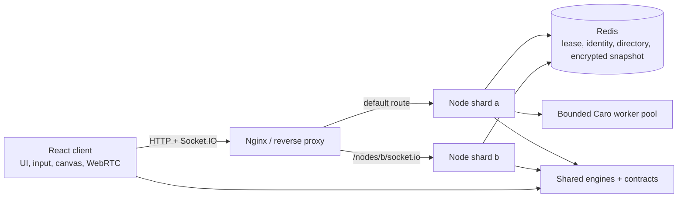
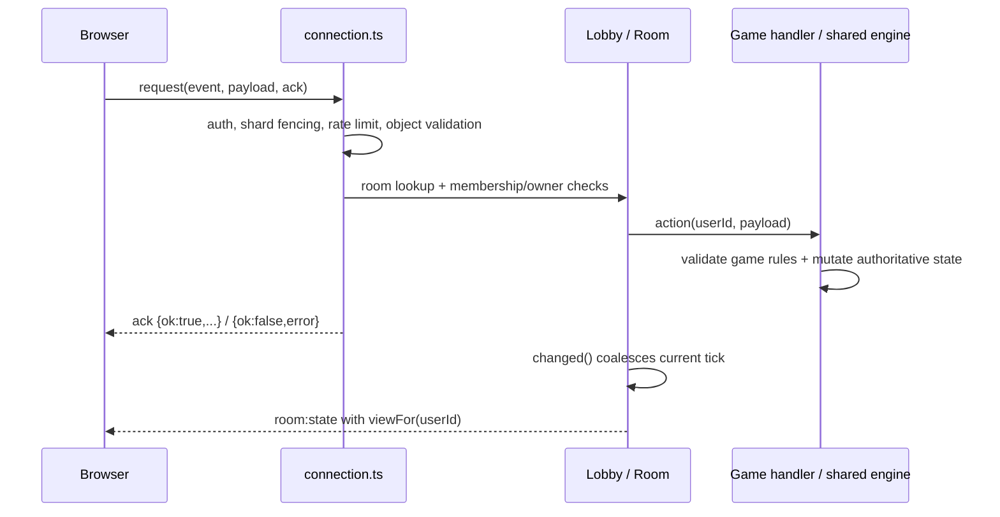

# Tổng quan kiến trúc hiện tại

Tài liệu mô tả implementation trong repo: monorepo npm workspaces (`shared`, `server`, `client`), TypeScript strict, ESM. Có chế độ một Node process và chế độ cluster với Redis cùng proxy Nginx. Đây là ứng dụng giữ game state trong bộ nhớ, có checkpoint khi bật cluster; không phải hệ thống database giao dịch lưu lịch sử lâu dài.

## Các khối chính

Local một process có thể nối trực tiếp client → Node; Vite dev proxy `/socket.io` tới server. `REDIS_URL` không được đặt thì không dùng cluster/recovery. Khi bật cluster, mỗi process có `NODE_ID` ổn định, cùng `CLUSTER_NODES`, namespace, auth config và `SNAPSHOT_KEY`.

| Khối | Trách nhiệm |
| --- | --- |
| `shared/src` | Luật/thuật toán game, PRNG/replay, card helpers, Socket.IO contracts. Dùng từ Node và browser, không lệ thuộc framework/server infrastructure |
| `server/src/index.ts` | Composition root: HTTP, socket server, lobby, cluster/recovery, voice, metrics và shutdown |
| `config.ts`, `auth.ts`, `rateLimit.ts`, `http.ts` | Env/config, password/signed session, per-IP counters, security headers, static client, liveness/readiness và origin validation |
| `connection.ts` | Đăng ký request, auth/rate limit/payload boundary, ack success/error, orchestration lobby và voice |
| `lobby.ts` | Canonical users/rooms của shard, membership, owner, chat, voice membership, public envelope và lobby summaries |
| `games/` | Adapter từng game: điều phối engine, seats, ready/start, timer, bot, view theo người xem và dispose |
| `cluster.ts` | Lease ownership, identity metadata, room/presence directory, placement và identity transfer CAS |
| `snapshot.ts`, `recovery.ts`, `resumeRoom.ts` | Codec graph + encryption, checkpoint/restore, tái dựng timer theo deadline |
| `botPool.ts`, `botWorker.ts` | Caro search ngoài event loop, bounded concurrency/queue, timeout, bỏ kết quả stale |
| `client/src/socket.ts`, `store.tsx` | Request/ack, auth storage, shard redirect, reconnect, app phase, room/lobby state và toast |
| `client/src/components`, `games` | Shell/UI chung và màn hình/canvas từng game; phần prediction không thay server validation |
| `voice*.ts` | WebRTC negotiation và lifecycle; server cấp ICE/relay signal, browser truyền media trực tiếp |

Repo hiện có Cờ vua, Cờ tướng, Cờ caro, Poker, Tá lả, Sâm lốc, Nối từ, Đố vui, Đoán chữ, Vẽ đoán, Tam sao thất bản, Nối thú, Rắn săn mồi, Tetris, Bay qua khe và Đào vàng.

## State và protocol

`Lobby.users`, `byToken`, `rooms` là Map trong bộ nhớ shard. User có identity/token, logical server (sảnh), sockets của các tab, room và reconnect grace timer. Room có owner, members, chat, voice membership và một game handler. “Sảnh/server” theo mật khẩu là phân vùng logic; “shard/node” là process vật lý, không đồng nghĩa nhau.

Wire events/payloads/acks nằm ở `shared/src/contracts.ts`; compiler kiểm tra hai chiều và negative type tests. View của từng game nằm ở `shared/src/views.ts`: handler server khai báo `view(): XView`, `RoomState` là union phân biệt theo `game` nên client thu hẹp `room.state` bằng `switch (room.game)`, và kết quả `game:query` có kiểu theo loại truy vấn. Request không đáng tin dù có kiểu ở client; validation runtime vẫn bắt buộc.

Room xây phần public envelope một lần cho mỗi thay đổi, nhưng gọi `handler.view(uid)` riêng cho từng người. Private cards/secret word không đi vào shared public envelope. `changed()` gộp trong microtask; lobby broadcast gộp 100 ms và chỉ gửi room list/presence khi summary hoặc membership liên quan đổi. Drawing stream dùng đường riêng để không phát lại toàn room cho mỗi nét.

ReadyGate dùng chung bảo đảm người chơi sẵn sàng và chủ phòng bấm bắt đầu. Duel/CardTable chỉ gom lifecycle có cùng invariant; engine shared giữ luật. Nối thú/Rắn có xử lý cục bộ để tương tác mượt; với Rắn, server phát lại seed + inputs để tính state/điểm, không tin score client. Bay qua khe và Đào vàng dùng chung mô hình này qua `RaceHandler` (`server/src/games/race.ts`) và `replayRace` (`shared/src/race.ts`): lệnh `[tick, lệnh]`, đồng hồ server chặn chạy trước, người im lặng quá 4 giây bị đẩy đi tiếp; engine chỉ dùng số nguyên (không `Math.sin/cos`) để phát lại khớp mọi trình duyệt.

## Cluster và routing

- Phòng mới ưu tiên shard đang chứa nhiều phòng nhất của cùng sảnh, tràn sang shard khác khi lệch tải từ `affinitySlack` phòng; hạn mức `roomsPerServer` tính trên toàn cluster theo directory.
- Mỗi room chỉ được mutate trên một owner shard. Không có Redis Socket.IO broadcast adapter; room traffic ở local owner.
- Lease Redis sống 15 giây, renew bằng connection độc lập mỗi 2 giây. Mất lease/Redis thì fence node; request còn kiểm tra độ mới của lease. Không cho hai process cùng `NODE_ID` sở hữu shard.
- Directory metadata refresh mỗi 2 giây; node directory TTL 10 giây. Placement chọn node không draining có ít room hơn; đây là heuristic, không phải đo tải CPU.
- Identity/route metadata lưu Redis với TTL và transfer bằng compare-and-set. Chỉ rời membership cũ sau khi Redis commit transfer; identity đã chuyển bị fence đến khi owner mới nhận `hello`.
- Ack redirect gửi `nodeId`; browser lưu route/pending request trong sessionStorage, reload, nối `/nodes/<id>/socket.io`, `hello` rồi tiếp tục create/join. Proxy phải giữ cả WebSocket lẫn polling về cùng shard. Redirect có giới hạn số hop.
- Compose hiện định nghĩa node `a`, `b`, Redis private network và Nginx; default traffic vào node a. Node mới phải có route proxy tương ứng, không chỉ thêm vào env.

## Checkpoint, restart và shutdown

Cluster bật recovery với key 32 byte biểu diễn bởi 64 hex characters. Codec schema 1 giữ graph references/aliases, Map/Set, array, registered prototypes và function/PRNG được cho phép; dùng V8 serialization rồi AES-256-GCM. Timer/socket/voice membership và back-reference được bỏ khỏi dữ liệu lưu và dựng lại khi restore.

Checkpoint mỗi 2 giây, có giới hạn 32 MB, ghi bằng Lua kiểm tra owner lease. Restore nạp user/room/handler, gắn lại lobby/room, giữ private state, readiness, PRNG và deadline; `resumeRoom()` đặt timer từ thời gian tuyệt đối. Không gọi constructor/start để chia lại ván. Downtime vẫn tiêu thụ thời gian ván.

Shutdown: bỏ readiness → draining → freeze mutation → dispose timer → tick metadata/final snapshot → đóng voice/metrics/worker/socket/Redis. Có deadline thoát process. `/health` là process liveness, `/ready` phản ánh khả năng nhận traffic cùng draining/lease state.

Đây là restart recovery trên shard ID ổn định, không phải live room migration hay failover không gián đoạn. Crash có thể mất thay đổi sau checkpoint cuối; snapshots gắn schema/prototype của code hiện tại, chưa có migration framework cho mọi phiên bản. Giữ key ổn định và xem hướng dẫn backup trong [docker-setup.md](docker-setup.md).

## Voice và bảo vệ boundary

Voice là WebRTC mesh giữa browser, mỗi người có peer connection tới người còn lại. Server giữ membership, kiểm tra cùng room/tab, giới hạn signal và cấp STUN/TURN credentials. Perfect negotiation và hàng đợi ICE/SDP xử lý offer collision; disconnect/leave teardown tracks/peers. Node không chuyển tiếp media audio. TURN quota policy và configuration ở `voice.ts`.

Auth gate quyết định logical server theo password hoặc session ký HMAC. Origin/security headers, packet size, per-IP connection/new-user limits và token buckets bảo vệ runtime boundary. Các limit hiện phần lớn theo shard, chưa phải global quota toàn cluster. Metrics log định kỳ có memory, connections/rooms/identities và event-loop p95/p99; không suy ra capacity đảm bảo nếu chưa benchmark workload thực tế.

## Build và kiểm chứng

Source TS → shared/server ESM + declarations → copy `server/src/data` → Vite bundle client. Runtime Docker chỉ cần JS đã compile, runtime dependencies và assets; không cần tsx/TypeScript. Worker luôn dùng compiled `botWorker.js`, kể cả khi parent chạy tsx.

CI quality job chạy source policy, ESLint và strict typecheck cho source/config/scripts/tests; test job chạy luật, handler, worker, recovery và Redis thật; integration chạy compiled server; Docker build xác nhận đóng gói. Compose job dựng Redis + hai shard + Nginx và smoke routing/transfer/gameplay. Browser voice probes là lớp riêng cần môi trường thật, không được coi là đã chạy chỉ vì typecheck qua.

Đọc tiếp [feature-development.md](feature-development.md), [conventions.md](conventions.md), [typescript.md](typescript.md), [scaling.md](scaling.md), [docker-setup.md](docker-setup.md).

### Điều chỉnh Đào vàng và Bay qua khe

Đào vàng giảm tốc móc và tăng sức nặng vàng lớn/đá. Bay qua khe tạo phòng ở chế độ sinh tồn, không giới hạn điểm hoặc thời lượng; mỗi 10 cột thu hẹp khe 4px, tối đa 24px. Khe của mỗi cột cố định theo chỉ số để hiển thị và va chạm thống nhất. Lực nảy thấp hơn để dễ chỉnh độ cao.

Hai game hiển thị kỷ lục thiết bị (localStorage, từ điểm server xác nhận của những người chơi trên thiết bị) bên cạnh bảng kỷ lục phòng. Đây không phải bảng xếp hạng toàn hệ thống; xoá dữ liệu trình duyệt sẽ xoá kỷ lục thiết bị. Trên màn cảm ứng nhỏ, khi ván chạy, sân chơi phủ viewport và ẩn bảng phụ; nút bỏ cuộc vẫn truy cập được.
